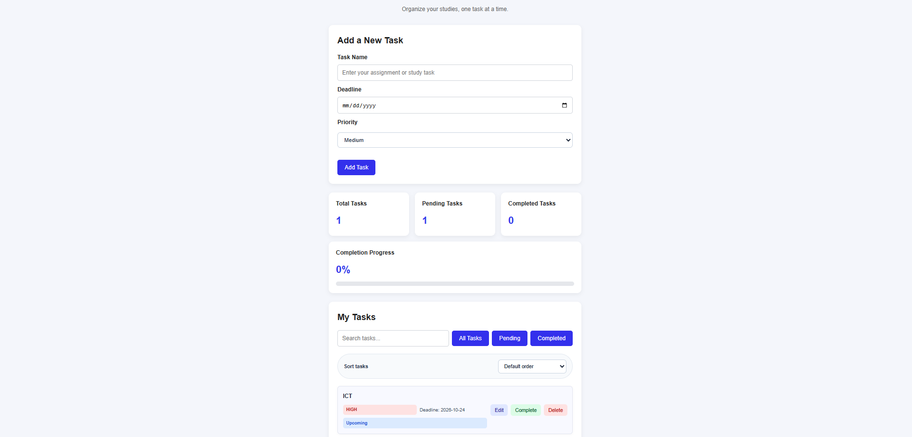

# Student Task Manager

A simple, responsive task management web application built with HTML, CSS, and JavaScript. It helps students organize assignments, manage deadlines, prioritize tasks, and track their progress.

## Features

- **Add Tasks** — Create tasks with a name, deadline, and priority.
- **Edit Tasks** — Update existing task details.
- **Delete Tasks** — Remove tasks you no longer need.
- **Complete Tasks** — Mark tasks as completed or undo completion.
- **Search Tasks** — Find tasks by name.
- **Filter Tasks** — View all, pending, or completed tasks.
- **Sort Tasks** — Sort by deadline or priority.
- **Deadline Status** — Identify overdue tasks, tasks due today, upcoming tasks, and completed tasks.
- **Progress Dashboard** — View total, pending, and completed tasks, plus your completion percentage.
- **Local Storage** — Keep your tasks saved in the browser after refreshing the page.
- **Responsive Design** — Use the application on desktop and mobile devices.
- **Empty States** — Display helpful messages when no tasks match the current view.

## Technologies Used

- HTML5
- CSS3
- JavaScript
- Browser Local Storage
- Git and GitHub

## Getting Started

### Prerequisites

You need a modern web browser and a code editor such as Visual Studio Code.

### Installation

1. Clone the repository:

   ```bash
   git clone YOUR_REPOSITORY_URL
   ```

2. Open the project folder:

   ```bash
   cd student-task-manager
   ```

3. Open `index.html` in your browser, or use the Live Server extension in Visual Studio Code.

No package installation or build process is required.

## Project Structure

```text
student-task-manager/
├── index.html
├── style.css
├── script.js
└── README.md
```

## How to Use

1. Enter a task name.
2. Select a deadline and priority.
3. Click **Add Task**.
4. Use the task actions to edit, complete, undo, or delete a task.
5. Search, filter, or sort tasks to find what you need.
6. Monitor your progress using the dashboard.

## Data Storage

The application uses browser Local Storage to save tasks under the `studentTasks` key. Tasks remain available after a page refresh in the same browser, provided the stored data is not cleared.

Local Storage is browser-specific and is not a cloud backup or account-based synchronization system.

## Screenshots

Add a screenshot of your application here.

```text
screenshots/
└── task-manager.png
```

```markdown

```

## What I Learned

Through this project, I practiced:

- Manipulating the DOM with JavaScript.
- Handling form submissions and button events.
- Working with arrays and objects.
- Implementing search, filtering, and sorting.
- Managing task data using unique IDs.
- Persisting data with Local Storage.
- Creating responsive layouts with CSS.
- Using Git and GitHub to manage a project.

## Future Improvements

- Add task categories.
- Add task reminders.
- Add dark mode.
- Add automated tests.

## Author

**Ravindu**

ICT Undergraduate | Aspiring Software Engineer

GitHub: [Your GitHub Profile](YOUR_GITHUB_PROFILE_URL)

---

This project was developed as part of my journey to improve my front-end development skills and prepare for a software engineering internship.
